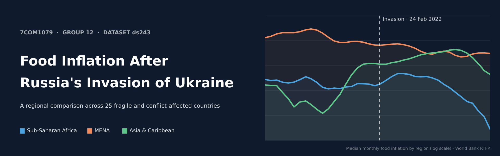

# 7COM1079-0901-2026-Group_Project_G12



In this project, our group was given a selected dataset. From it, we developed a research question (RQ) and the matching hypotheses, then produced visualisations and a statistical analysis to test them. The research question states the specific claim or issue under investigation, and it is the starting point for building and testing a meaningful argument.

**Module:** 7COM1079 Team Research and Development Project, University of Hertfordshire
**Group:** G12
**Dataset:** ds243, World Bank Real-Time Food Prices (RTFP)

---

## Research question

> Is there a difference in the mean change in year-on-year food price inflation, from the 12 months before (March 2021 – February 2022) to the 12 months after (March 2022 – February 2023) Russia's invasion of Ukraine, between Sub-Saharan Africa, the Middle East and North Africa (MENA), and Asia & the Caribbean?

### Hypotheses

- **H0:** There is no difference in the mean change in food price inflation between the three regions.
- **H1:** There is a difference in the mean change in food price inflation between at least two of the regions.

The test is two-tailed at the 5% significance level (α = 0.05).

### Variables

| Variable | Type | Description |
|---|---|---|
| Region (independent) | Nominal, 3 groups | Sub-Saharan Africa (17 countries), MENA (4), Asia & Caribbean (4) |
| Change in food inflation (dependent) | Continuous | Each country's average inflation after the invasion minus its average before, in percentage points |

The unit of analysis is the country.

---

## Dataset

- **File:** `data/raw/WLD_RTFP_country_2023-10-02.csv`
- **Source:** World Bank Real-Time Food Prices, version 2 October 2023 (Andrée, 2021; doi:10.48529/5hgz-q149)
- **Size:** 4,798 monthly observations for 25 fragile and conflict-affected countries, January 2007 – October 2023
- **Columns:** `Open`, `High`, `Low`, `Close` (food price index, local currency), `Inflation` (year-on-year food inflation, %), `country`, `ISO3`, `date`

The raw file is never edited. All processing is done in `Analysis.R`.

---

## Repository structure

```text
7COM1079-0901-2026-Group_Project_G12/
├── 7COM1079-0901-2026-Group_Project_G12.Rproj   # open this in RStudio
├── Analysis.R                                   # all code, one section per member
├── README.md
├── .gitignore
├── assets/
│   └── banner.png                               # README banner image
├── data/
│   ├── raw/WLD_RTFP_country_2023-10-02.csv      # original dataset
│   └── processed/country_change.csv             # one row per country (made by Analysis.R)
└── figures/
    ├── fig1_histogram.png                       # Figure 1
    ├── fig2_boxplot_by_region.png               # Figure 2
    └── table1_summary_by_region.csv             # summary table for the report
```

---

## How to run

1. Open `7COM1079-0901-2026-Group_Project_G12.Rproj` in RStudio.
2. Open `Analysis.R` and click **Source**.
3. The figures and tables are saved in the `figures/` folder.

To save the full output log (for the report appendix), run this in the R Console:

```r
system2(file.path(R.home("bin"), "Rscript"), "Analysis.R",
        stdout = "Rscript.log", stderr = "Rscript.log")
```

No extra packages are needed. The code uses base R only.

---

## What `Analysis.R` does

| Section | Owner | What it does | Output |
|---|---|---|---|
| 1. Prepare the data | Alif | Keeps the 24 months around the invasion, labels Before/After and region, and calculates each country's change | `data/processed/country_change.csv` |
| 2. Descriptive statistics | Hisam | Summary, standard deviation, and median and mean change by region | Console output |
| 3. Figure 1 – histogram | Latifi | Distribution of the change across all 25 countries | `figures/fig1_histogram.png` |
| 4. Figure 2 – boxplot by region | Muiz | Compares the change between the three regions (main plot) | `figures/fig2_boxplot_by_region.png` |
| 5. Summary table | Marvin | Median change, number of countries, and how many rose, per region | `figures/table1_summary_by_region.csv` |
| 6. Statistical tests | Team | Shapiro–Wilk normality test, Kruskal–Wallis test, pairwise Wilcoxon tests (Holm-adjusted) | Console output / `Rscript.log` |

### Why these methods

- **Histogram + boxplot:** the module's recommended visualisations for comparing a continuous variable across groups.
- **Kruskal–Wallis test:** the change is not normally distributed, and there are three independent groups, so a non-parametric test is used instead of one-way ANOVA. Pairwise Wilcoxon tests then show which regions differ.

---

## Team

| Member | Role |
|---|---|
| Alif | Data preparation (Section 1) |
| Hisam | Descriptive statistics (Section 2) |
| Latifi | Histogram, Figure 1 (Section 3) |
| Muiz | Boxplot, Figure 2 (Section 4) |
| Marvin | Summary table and README (Section 5) |

All members also reviewed one section written by another member.

---

## Working with Git

- Commits are made from RStudio's Git tab, using each member's University of Hertfordshire email.
- Before starting any work: **Pull**. After finishing: **Commit**, then **Push**.
- Members work on `Analysis.R` one at a time, to avoid merge conflicts.

---

## Reference

Andrée, B.P.J. (2021) *Monthly food price estimates by product and market* (Version 2023-10-02). World Bank Microdata Library. doi:10.48529/5hgz-q149.
